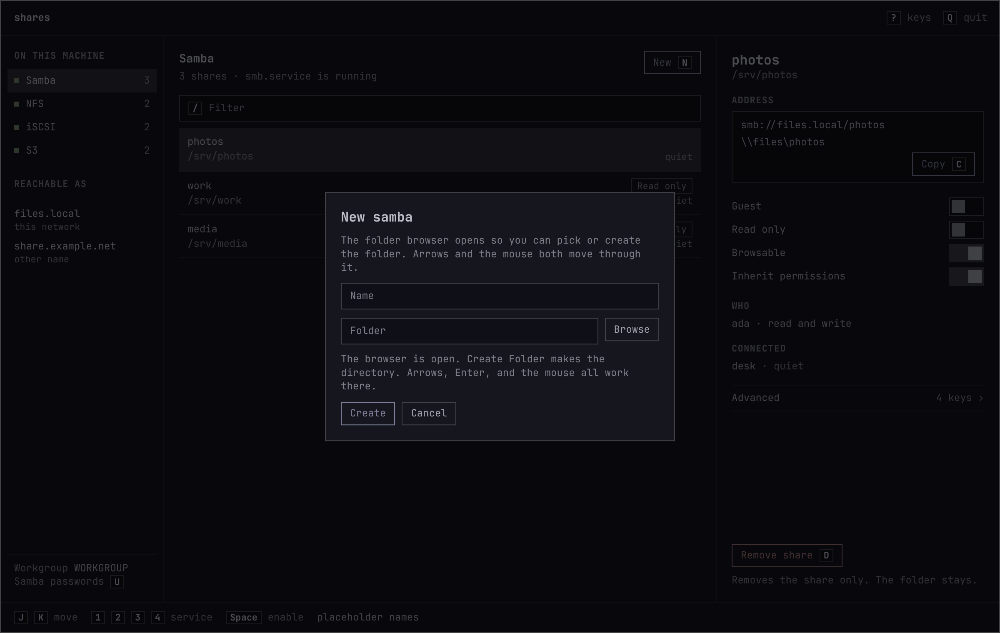
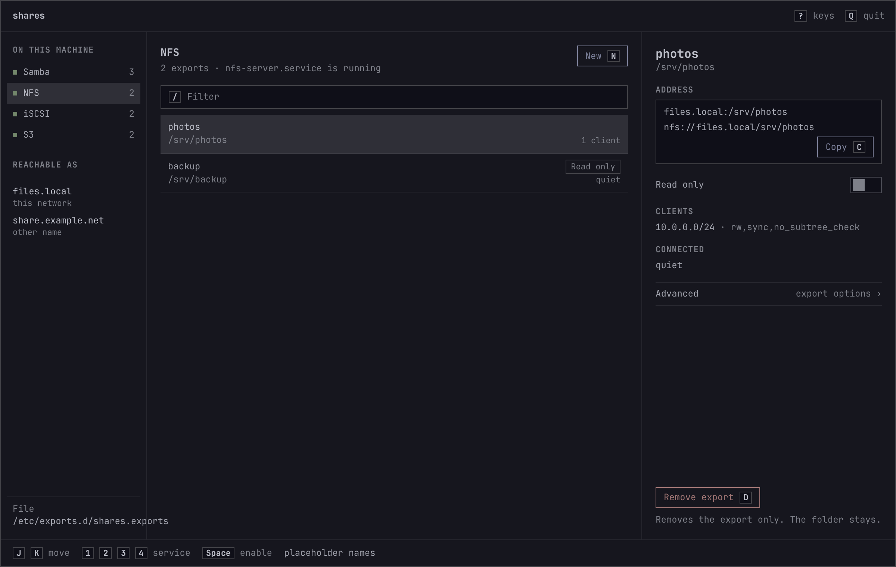
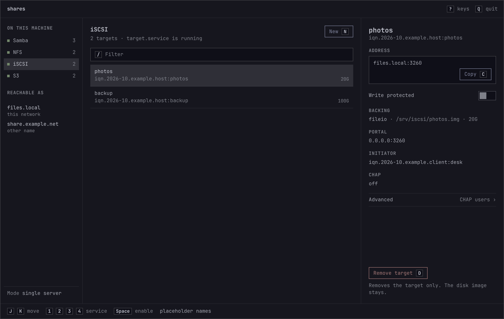
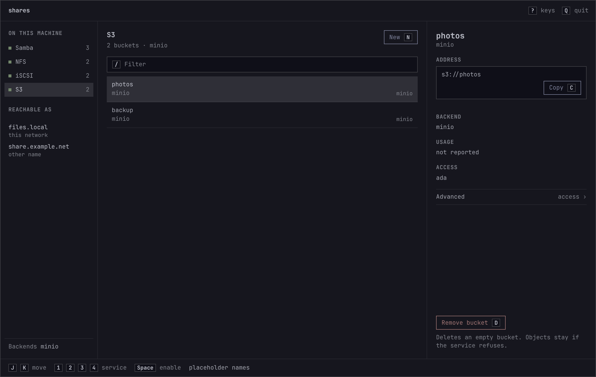

# Shares

A keyboard-first window for publishing folders over Samba and NFS, disks over iSCSI, and buckets on a local S3 service. It can manage this computer, or another computer over SSH, including machines that are on a Tailscale network. It follows the Omarchy theme and installs like any other Arch package.

The pictures use placeholder names. The installed window reads this machine at startup and does not keep those names.









## Credit

The idea of one screen for Samba, NFS, iSCSI, and S3 comes from [45Drives' cockpit-file-sharing](https://github.com/45Drives/cockpit-file-sharing). That project is a Cockpit plugin and is licensed GPL-3. Shares does not include its source. The window, the code, and the packaging here are new.

45Drives and Cockpit are names of their respective projects.

## What it writes

Edits stay in the window until you press `Ctrl+S`. Saving the real machine asks for an administrator through polkit, then writes:

| Service | Files and tools |
|---|---|
| Samba | `/etc/samba/shares.conf`, an `include` line in `smb.conf`, `smbpasswd` for Samba passwords |
| NFS | `/etc/exports.d/shares.exports`, then `exportfs -ra` |
| iSCSI | `/etc/shares/iscsi.json`, then `targetcli` (or `gwcli` and `rbd` when clustered) |
| S3 | `mc`, `garage`, `radosgw-admin`, or `curl` against the RustFS admin API on `127.0.0.1` |

If `smb.conf` still has its own share sections, Save moves them into `shares.conf` and keeps the previous file as `smb.conf.bak`.

Removing a share, export, or target removes that definition only. The folder or disk image stays. Removing an S3 bucket asks the service to delete it and leaves the bucket in place when it is not empty.

Samba can set guest access, read only, browsable, inherit permissions, valid users, Windows ACLs, ZFS or Ceph shadow copies, the MacOS fruit preset, audit logging, a directory mode, and creating a missing folder. Extra `smb.conf` keys are kept. Global settings cover the workgroup, server string, log level, and the MacOS preset. A Samba password does not change the Linux login password.

## ZFS

A folder on a ZFS dataset can be a Samba share or an NFS export. A file on that dataset can be an iSCSI disk image. A zvol can be an iSCSI block device when its path is `/dev/zvol/pool/name` and the backstore kind is block.

Turn on Shadow copy for a Samba share. The shadow kind stays `zfs` unless you set it to `ceph`. Save then writes:

```
vfs objects = shadow_copy2
shadow:snapdir = .zfs/snapshot
shadow:sort = desc
shadow:format = %Y-%m-%d-%H%M%S
```

Windows Previous Versions lists those snapshots when the share path is the dataset mount, so `.zfs/snapshot` is inside that folder, and each snapshot name looks like `2026-10-11-143000`.

Shares does not create datasets, snapshots, or zvols. Create Folder makes a directory on the dataset that is already mounted. Snapshots stay a `zfs snapshot` job. An NFS export is written to `/etc/exports.d/shares.exports`. Removing a share, export, or target leaves the dataset, its snapshots, and any zvol in place.

NFS exports take one or more clients, each with its own options. iSCSI targets take a file or block backstore, portals, initiator groups, and CHAP. Clustered mode creates an RBD image and uses `gwcli` when those tools are installed. It does not manage Pacemaker or Ceph monitors.

S3 lists, creates, and deletes buckets for MinIO (`mc` alias `local`), Garage, and RustFS, and lists and removes empty Ceph RGW buckets. Access users and keys can be created for MinIO, Garage, and Ceph. Ceph creates a bucket through the S3 API, so this window does not. RustFS access keys are listed and not created here. Policies, groups, versioning, and object lock are not in this window.

A missing tool is named in the window. On this computer, Shares does not install packages for you. On another computer, it lists what is missing and can install that list after you confirm.

Names this machine is reachable as are read when the window opens. They are not stored in the program.

## Other computers

Press `H`, or the H in the top bar. This computer is always first. `J` and `K` move through the list, and Enter opens the highlighted computer.

If Tailscale is running on this computer, Shares reads `tailscale status` and lists the peers that are online. Each peer has a user and a password. The user is remembered in the Shares config file. The password is used for that connection and is not written down. Leave the password empty and a peer with Tailscale SSH is opened with `tailscale ssh`. Any other peer is opened with OpenSSH to its MagicDNS name, or to its Tailscale address when that name is empty, using the SSH key you already have. A password uses OpenSSH instead, and Shares asks SSH for that password without putting it on the command line.

The Computers window also has **Windows shares**. Enter a Windows or SMB server name or LAN IP to list its visible shares, then open one in your file manager. Share discovery uses `smbclient`; opening a share needs your desktop's SMB file manager support, such as `gvfs-smb`. Credentials are used for discovery only and are not saved. Your file manager may ask for them again when you open a share.

A computer that is not on the tailnet can be typed as a user, a host or LAN IP address, a port, and an optional SSH password. Passwords are used for the connection only and are not saved; leave the field empty to use your SSH key. The host name, user, and port are kept in the Shares config file, readable only by you. The first connection requires a host key you already trust. Trust key accepts that key once. Later connections check it again.

The other computer does not need this window. It needs OpenSSH (`sshd`) or Tailscale SSH, `python3`, and passwordless `sudo` for the SSH user. Shares copies a small apply helper there and sends the same file plan it would write locally. The helper allows the same paths and commands, and a removal still leaves the folder, disk image, dataset, or zvol in place.

When a tool is missing, the window lists it and the exact install command. Install runs only after you press Install, and only when `sudo -n` already works. If a password is required, the window shows the command and does not prompt. S3 packages are not part of that install.

| | Arch | Debian, Ubuntu, Proxmox |
|---|---|---|
| Samba | `samba`, unit `smb` | `samba`, unit `smbd` |
| NFS | `nfs-utils`, unit `nfs-server` | `nfs-kernel-server`, unit `nfs-server` |
| iSCSI | `targetcli-fb`, unit `target` | `targetcli-fb`, unit `rtslib-fb-targetctl` |

`python3` is included when it is missing. The helper is what applies the save, so the Shares package itself is not installed on the server.

New for Samba, NFS, and iSCSI opens the system file browser. Create Folder makes the directory. The list takes the keyboard and the mouse. `Ctrl+O` opens the browser again, and the path can still be typed. That browser needs `xdg-desktop-portal`.

## Install

Clone the repository and install the package:

```sh
git clone https://github.com/wouldja/shares.git
cd shares
bin/install
```

`bin/install` builds with `qmake6` and installs the `shares` package with `makepkg -fsi`. Shares then shows up in the app launcher. Run it with `shares`.

To build and run it without installing:

```sh
bin/build
./build/shares
```

Run the tests with `bin/test`.

The build needs `base-devel`, `qt6-base`, `qt6-declarative`, and `qt6-wayland`. Omarchy already includes these. If `qmake6` is missing:

```sh
omarchy pkg add base-devel qt6-base qt6-declarative qt6-wayland
```

Install a service only when you want that protocol: `samba`, `nfs-utils`, `targetcli-fb`, `mc`, `garage`, `ceph`, or `curl` for RustFS. SMB browsing uses `smbclient` and `gvfs-smb`, which the package installs. Saving needs `polkit`. RustFS is managed at `http://127.0.0.1:9000` unless `/etc/shares/s3.json` sets another loopback port.

Regenerate the pictures in `docs/` with `docs/mockups/render.py`, then screenshot each HTML page at 1200×760.

## Keys

| Key | Action |
|---|---|
| `?` | Show or hide this list |
| `Q` | Quit. Asks first when a save is waiting |
| `1` `2` `3` `4` | Samba, NFS, iSCSI, S3 |
| `J` `K` | Move through the list |
| `/` | Filter |
| `H` | Computers on SSH or Tailscale |
| `N` | New share, export, target, or bucket. Opens the folder browser |
| `Ctrl+O` | Open the folder browser again while creating |
| `E` | Edit the selected row |
| `G` | Samba global settings |
| `I` | Import or export this service |
| `C` | Copy the address |
| `Space` | Enable or disable the selected row |
| `D` | Remove, then confirm |
| `U` | Samba passwords, or S3 access keys |
| `Ctrl+S` | Save |
| `Ctrl+Z` | Undo |
| `Ctrl+Shift+Z` | Redo |

A field keeps its own keys. `Esc` closes the open dialog. The backdrop does not.

## License

MIT. See [LICENSE](LICENSE).

The theme watcher in `src/theme.cpp` and the folder browser in `src/portalfilepicker.cpp` follow Omacut, which is MIT, copyright David Heinemeier Hansson.
